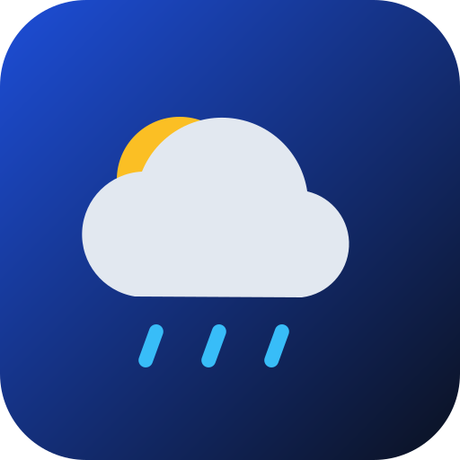
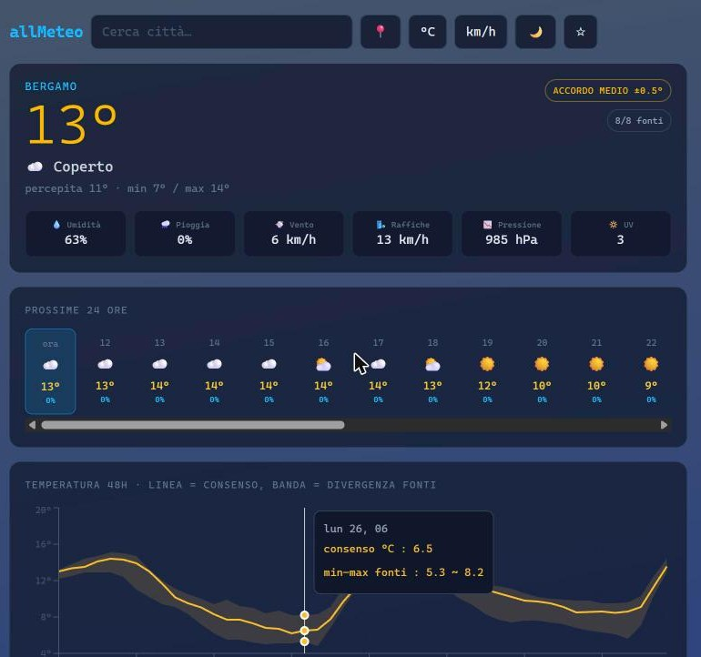
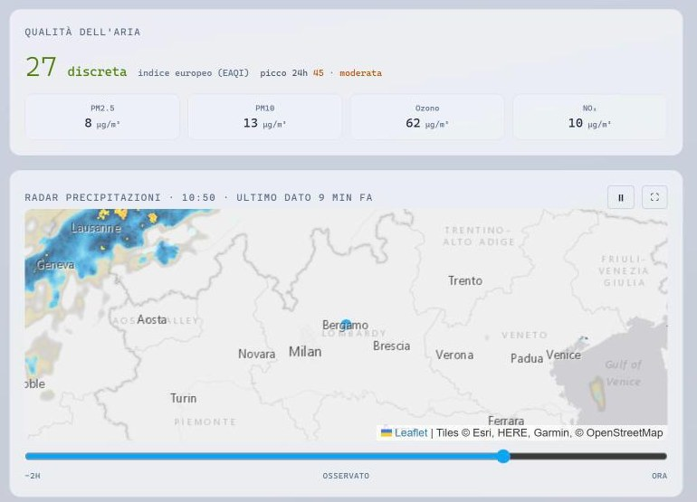

<div align="center">



# allMeteo

**One forecast you can trust, built from many.**

allMeteo asks up to 12 weather models at once, merges them into a single consensus
forecast and tells you how much they agree.<br>
No ads, no accounts, no API keys. It installs on your phone and works offline.

[](https://github.com/Omar76901/all-meteo/actions/workflows/ci.yml)
[](https://github.com/Omar76901/all-meteo/actions/workflows/upstream-check.yml)
[](LICENSE)


### [**▶ Open the live app**](https://omar76901.github.io/all-meteo/)



</div>

---

## Why allMeteo?

Every weather app shows **one** model's opinion and hides how uncertain it is. But models
disagree, especially a few days out or in the mountains, and the one your app picked
is not always right.

allMeteo takes a different approach:

- 🌍 **Asks everyone.** ECMWF, ICON, GFS and MET Norway, plus the high-resolution regional
  model for your area (ICON-2I in Italy, AROME in France, HRRR in the US, …).
- 🎯 **Merges smartly.** A weighted median, robust to the one model that goes off on its own.
  Regional 1–3 km models count double where they cover you.
- 📊 **Shows the uncertainty.** An agreement badge (`±0.5°`) and a band on the temperature
  chart between the coldest and the warmest model: a wide band means "don't trust the detail".

## Features

<table>
<tr>
<td width="50%" valign="top">

**Forecast**
- Consensus of up to 12 sources, with agreement index
- Current conditions, next 24 hours, 7 days
- 48-hour charts: temperature with divergence band,
  rain, wind with direction, pressure, humidity, UV
- Side-by-side comparison of every source

**Alerts & environment**
- Heat, frost, wind, gusts, heavy rain, storms, snow, UV
  alerts derived from the next 48 hours
- European Air Quality Index, PM2.5, PM10, O₃, NO₂
- Pollen in season (grasses, birch, olive, ragweed, …)
- Animated precipitation radar, full screen

</td>
<td width="50%" valign="top">

**Everyday comfort**
- City search, GPS, favourites
- Shareable links: `…/all-meteo/?lat=45.7&lon=9.7&name=Bergamo`
- Opens instantly with the last forecast, then refreshes
- °C / °F and km/h, m/s, knots, mph
- Dark, light or system theme; background that follows
  the weather and the time of day

**App**
- Installable PWA on Android, iOS and desktop
- Works offline with the last data
- Updates itself automatically
- No tracking, no cookies, no backend

</td>
</tr>
</table>

<div align="center">

</div>

## Data sources

| | Source | What it provides |
|---|---|---|
| 🌐 | [Open-Meteo](https://open-meteo.com) | Global models **ECMWF**, **ICON**, **GFS**; geocoding; air quality & pollen (CAMS) |
| 🎯 | Regional models via Open-Meteo | **ICON-2I** (Italy), **ICON-CH2** (Alps), **ICON-D2** (Central Europe), **AROME** (France), **UKV** (UK), **HRRR** (USA), **HRDPS** (Canada), **MSM** (Japan), used only where they cover the location |
| 🇳🇴 | [MET Norway](https://api.met.no) | An independent forecast |
| 📡 | [RainViewer](https://www.rainviewer.com) | Precipitation radar |
| 🗺️ | Esri Gray Canvas · © OpenStreetMap | Basemap |
| 📍 | [BigDataCloud](https://www.bigdatacloud.com) | Place name from GPS |

All free and key-less. A [daily automated check](docs/ci-and-security.md#daily-upstream-check)
makes sure each one still works.

## How the consensus works

```
 ECMWF   12.6°  ─┐
 ICON    13.0°  ─┤
 GFS     11.0°  ─┼──▶  weighted median  ──▶  12.8°   accordo medio ±1.0°
 MET     12.9°  ─┤     (regional ×2)
 ICON-2I 12.8°  ─┘                           (spread 11.0° → 13.0°)
```

Numeric values use a **weighted median**, wind direction a **circular mean** (the average
of 350° and 10° is 0°, not 180°), and the sky condition a **weighted vote** where ties go
to the more severe weather. Details in [docs/consensus.md](docs/consensus.md).

## Quick start

```bash
git clone https://github.com/Omar76901/all-meteo.git
cd all-meteo
npm ci          # exact, locked dependency versions
npm run dev     # → http://localhost:5173
```

| Command | |
|---|---|
| `npm test` | Run the test suite (Vitest) |
| `npm run build` | Production build into `dist/` |
| `npm run preview` | Serve the production build locally |
| `node scripts/check-upstreams.mjs` | Check that every external service is up |

### Run it on your home network with Docker

```bash
docker compose up -d --build
```

Then open `http://<your-PC-IP>:8080` from any device on the LAN. It runs on non-root nginx.
Offline mode and installation need HTTPS, see [deployment](docs/deployment.md#docker-on-your-lan).

## Built with

React 19 · TypeScript · Vite · Tailwind CSS v4 · Recharts · Leaflet · Workbox (vite-plugin-pwa) · Vitest

## Quality & security

- **Three-stage CI**: gitleaks, Trivy and Bearer first; then `npm audit`, typecheck,
  tests and build; then deploy to GitHub Pages
- **Strict Content Security Policy**, no third-party scripts, no CDN at runtime
- **Pinned dependencies** with a committed lockfile, updated weekly by Dependabot
- **Daily upstream check** that catches silent API changes, such as a tile server
  answering `200 OK` with an "API KEY REQUIRED" image

## Documentation

| | |
|---|---|
| [Architecture](docs/architecture.md) | Layers, data model, data flow, state, theming, offline |
| [Data sources](docs/data-sources.md) | Every API, the exact requests, normalisation |
| [Consensus algorithm](docs/consensus.md) | Weights, median, circular mean, agreement index |
| [Features](docs/features.md) | Every panel, alert thresholds, AQI bands |
| [Development](docs/development.md) | Setup, structure, testing, conventions, how to extend |
| [Deployment](docs/deployment.md) | GitHub Pages, Docker, CSP, PWA caching |
| [CI & security](docs/ci-and-security.md) | Pipeline, upstream check, Dependabot |
| [Troubleshooting](docs/troubleshooting.md) | Known problems and their fixes |

## License

Released under the [PolyForm Noncommercial License 1.0.0](LICENSE).
You are free to use, study, modify and share this software for **personal and
non-commercial** purposes. **Any commercial use, such as selling it, reselling it or
offering paid services based on it, is not allowed.**

Weather data © the respective providers: Open-Meteo (CC BY 4.0), MET Norway (CC BY 4.0),
RainViewer, Copernicus/CAMS, Esri and OpenStreetMap contributors.
