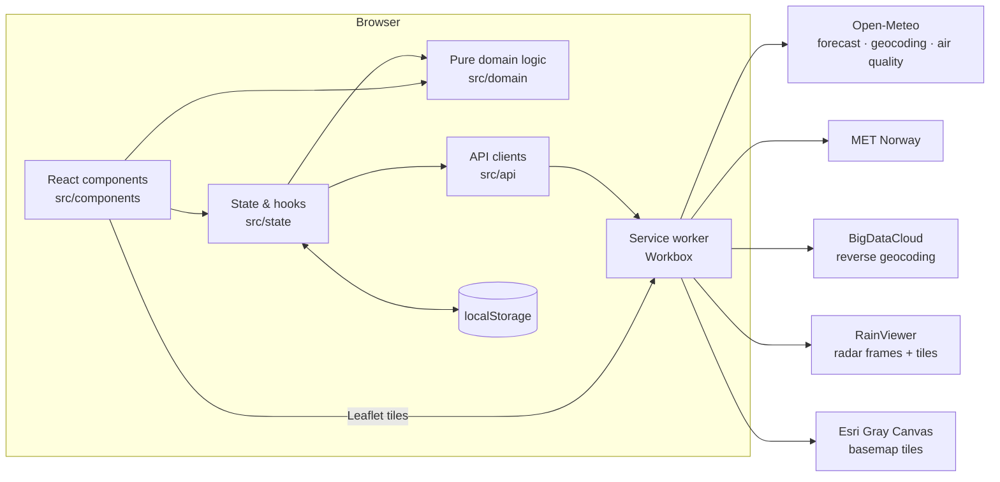

# Architecture

allMeteo is a **static single-page application**. There is no backend: the browser
talks directly to public, key-less weather APIs, merges their answers into one
consensus forecast and renders it. Everything the app remembers (favourites, last city,
units, theme, last forecast) lives in the browser's `localStorage`.



## Layers

The code is split by responsibility, and dependencies only point "downwards":
components → state → api/domain. `domain/` never imports from React or from `api/`.

| Folder | Responsibility | React? | Network? |
|---|---|---|---|
| `src/api/` | One module per external service: build the URL, fetch, **normalise** the response into the shared types | no | yes |
| `src/domain/` | Pure functions: consensus, alerts, units, weather codes, backgrounds, time formatting | no | no |
| `src/state/` | Hooks and contexts: weather loading, persisted settings, units, theme, URL sync | yes | via `api/` |
| `src/components/` | Presentational React components, one panel per file | yes | only `AirQualityCard` and `RadarMap` fetch their own data |

Keeping `domain/` pure is what makes most of the app testable without mocks: the
consensus, alerts and unit conversions are tested with plain arrays.

## The normalised data model

Every forecast source, whatever its native format, is converted into a
`SourceForecast` (`src/domain/types.ts`):

```ts
interface SourceForecast {
  sourceId: string;          // 'ecmwf' | 'icon' | 'gfs' | 'met_norway' | local model id
  sourceName: string;
  timezone: string | null;   // IANA timezone of the location, when the source knows it
  hourly: HourlyPoint[];     // every timestamp is ISO 8601 UTC
  daily: DailyPoint[];       // may be empty (MET Norway has no daily block)
  local?: boolean;           // high-resolution regional model → double weight
}
```

Conventions that every parser respects:

- **Times are ISO 8601 in UTC** (`2026-07-15T12:00:00.000Z`). Conversion to the
  location's timezone happens only when formatting (`domain/timeUtils.ts`).
- **Daily dates are local calendar dates** (`YYYY-MM-DD`).
- **Units are fixed internally:** °C, km/h, mm, hPa, %. The user's unit choice
  (°F, m/s, knots, mph) is applied only at display time, so alert thresholds and the
  consensus never depend on it.
- **Missing values are `null`**, never `0` or `undefined`, so the consensus can tell
  "no data" from "zero".

## Data flow of a forecast

1. **City selection** — `App` picks the city from the URL (`?lat=&lon=&name=`), falling
   back to the last used city in `localStorage`. Search (Open-Meteo geocoding) and
   GPS (browser geolocation + BigDataCloud reverse geocoding) can change it.
2. **Instant preview** — `useWeather` looks for a saved snapshot of that city (at most
   12 hours old) and renders it immediately.
3. **Parallel fetch** — `fetchAllSources` (`src/api/sources.ts`) starts three requests
   at once with `Promise.allSettled`:
   - one multi-model Open-Meteo request for the global models (ECMWF, ICON, GFS);
   - one multi-model Open-Meteo request for all regional high-resolution models;
   - MET Norway.

   A failing request never breaks the others: it ends up in the `failed` list and is
   shown as "non disponibile" in the source comparison table.
4. **Consensus** — `buildConsensus` (`src/domain/consensus.ts`) merges all sources hour
   by hour and day by day. See [consensus.md](consensus.md).
5. **Persist & render** — the result is saved as the new snapshot and rendered. Alerts
   are derived from the next 48 hours of the consensus (`domain/alerts.ts`).
6. **Refresh** — the forecast reloads every 15 minutes, only while the tab is visible.
   Stale responses (from a city the user has already left) are discarded with a request
   sequence counter.

Two panels load their own data independently, because they are accessory and must not
delay or break the main forecast:

- `AirQualityCard` → Open-Meteo Air Quality; hides itself on error.
- `RadarMap` → RainViewer frame list, refreshed every 10 minutes.

## State and persistence

| Key in `localStorage` | Written by | Content |
|---|---|---|
| `allmeteo:favorites` | `state/settings.ts` | Favourite cities |
| `allmeteo:lastCity` | `state/settings.ts` | Last selected city |
| `allmeteo:snapshot` | `state/settings.ts` | Last successful fetch for one city (sources + failures + timestamp) |
| `allmeteo:units` | `state/units.tsx` | `{ temp: 'C' \| 'F', wind: 'kmh' \| 'ms' \| 'kn' \| 'mph' }` |
| `allmeteo:theme` | `state/theme.tsx` | `'dark' \| 'light' \| 'auto'` |

Every read and write is wrapped in `try/catch`: in private mode or with storage full the
app keeps working, it simply forgets.

Units and theme are exposed through React contexts (`UnitsProvider`, `ThemeProvider` in
`main.tsx`). Without a provider (e.g. in component tests) the contexts fall back to the
defaults, °C, km/h and dark theme.

## Theming

The light theme does not duplicate any Tailwind class. `ThemeProvider` sets
`data-theme="light"` on `<html>`, and `src/index.css` redefines the Tailwind v4 palette
variables under that selector:

- the **slate scale is inverted** (`slate-950` ↔ `slate-50`, `900` ↔ `100`, …), so
  dark panels become light panels and light text becomes dark text;
- the **light accent shades** (`amber/sky/emerald/rose/… 300` and `400`), chosen for a
  dark background, take the darker `700`/`800` tones so they stay readable.

Two places cannot use CSS variables and switch explicitly on the theme:
the Recharts colours (SVG attributes) in `ChartsSection.tsx` and the Esri basemap URL
(dark or light gray) in `RadarMap.tsx`. The weather-dependent background gradient is
kept in light mode under a semi-transparent light veil.

## Offline and PWA

`vite-plugin-pwa` generates a Workbox service worker that:

- **precaches** the app shell (HTML, JS, CSS, icons, manifest), so the app opens offline;
- caches **weather API responses** with *stale-while-revalidate* (40 entries, 3 hours);
- caches **map and radar tiles** *cache-first* (200 entries, 30 minutes).

Together with the saved snapshot, this means a phone with no signal still shows the last
forecast instead of an error. The app is installable (manifest with 192/512 and maskable
icons, `display: standalone`) and updates itself automatically (`registerType: 'autoUpdate'`).

## Related documents

- [Data sources](data-sources.md): every external service and how it is normalised
- [Consensus algorithm](consensus.md)
- [Features](features.md): what the user sees, with thresholds and rules
- [Deployment](deployment.md) and [CI & security](ci-and-security.md)
