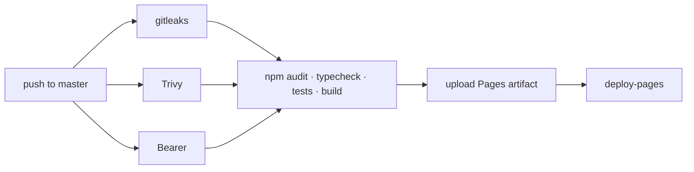

# Deployment

The build output (`dist/`) is a folder of static files, so allMeteo can be hosted
anywhere that serves files over HTTPS. Two setups are maintained: **GitHub Pages**
(the public site) and **Docker + nginx** (for a home network).

## GitHub Pages (production)

Live at **https://omar76901.github.io/all-meteo/**.

Every push to `master` runs the CI pipeline (`.github/workflows/ci.yml`); when the security
and test stages pass, the last stage deploys to Pages:



Notes:

- The site lives in a sub-path, so the build runs with
  `--base=/${{ github.event.repository.name }}/`. Vite rewrites asset URLs, and
  vite-plugin-pwa uses the base as manifest `scope` and `start_url` and as the service
  worker scope.
- Pull requests run the first two stages with the same build command, but do not deploy.
- One-time setup: *Settings → Pages → Source: GitHub Actions*.

## Docker on your LAN

```bash
docker compose up -d --build
```

- **Build stage**: `node:24.18.0-alpine`, `npm ci` with the locked dependencies, `npm run build`
  (base `/`).
- **Runtime stage**: `nginxinc/nginx-unprivileged` (runs as a non-root user, UID 101) serving
  `dist/` on port **8080**.

Open `http://localhost:8080` on the host, or `http://<host-LAN-IP>:8080` from other devices.
On Windows you may need to allow port 8080 in the firewall for Docker.

> **Service worker over LAN:** browsers only enable service workers on secure origins
> (HTTPS or `localhost`). From `http://192.168.x.x:8080` the site works normally, but offline
> caching and "install app" are unavailable. Put it behind HTTPS (e.g. a reverse proxy with a
> certificate) if you need them.

### nginx configuration

`nginx.conf`:

| Location | Behaviour |
|---|---|
| `/sw.js` | `Cache-Control: no-cache`: the service worker must always be re-checked so updates arrive |
| `/assets/` | `Cache-Control: public, max-age=31536000, immutable`: files have a content hash in their name |
| `/` | SPA fallback: `try_files $uri $uri/ /index.html` |

gzip is enabled for CSS, JS, JSON, SVG and the web manifest, and `server_tokens off`
hides the nginx version.

Every response also carries the security headers from `nginx-security-headers.conf`
(copied to `/etc/nginx/security-headers.conf` by the Dockerfile):

| Header | Value |
|---|---|
| `Content-Security-Policy` | `frame-ancestors 'none'` (the rest of the CSP is in the `<meta>` tag, where `frame-ancestors` is ignored) |
| `X-Frame-Options` | `DENY` |
| `X-Content-Type-Options` | `nosniff` |
| `Referrer-Policy` | `strict-origin-when-cross-origin` |
| `Cross-Origin-Opener-Policy` | `same-origin` |
| `Permissions-Policy` | only `geolocation=(self)`; camera, microphone, payment, USB, Bluetooth, serial disabled |

The file is `include`d in the server block **and** in every location that has its own
`add_header`: in nginx, an `add_header` inside a location discards all the ones inherited
from the server.

## Content Security Policy

In production builds a `<meta http-equiv="Content-Security-Policy">` is injected at the top
of `index.html` by the small `inject-csp` plugin in `vite.config.ts` (only on `build`,
because in dev it would block Vite's HMR websocket):

```
default-src 'self';
script-src 'self';
style-src 'self' 'unsafe-inline';
img-src 'self' data: blob: https://server.arcgisonline.com https://tilecache.rainviewer.com;
connect-src 'self' https://api.open-meteo.com https://geocoding-api.open-meteo.com
            https://air-quality-api.open-meteo.com https://api.met.no
            https://api.bigdatacloud.net https://api.rainviewer.com;
font-src 'self'; worker-src 'self'; manifest-src 'self';
base-uri 'self'; form-action 'self'; object-src 'none'
```

- No third-party scripts and no CDN assets at runtime: everything is bundled.
- `'unsafe-inline'` for styles is required by inline `style` attributes: the dynamic background, Leaflet and Recharts.
- **Any new external host must be added here**, or the production site will silently block
  it while the dev server works.

## Progressive Web App

Configured in `vite.config.ts` through `VitePWA`:

| Setting | Value |
|---|---|
| Manifest | name/short_name `allMeteo`, `lang: it`, `display: standalone`, theme and background `#0b1120` |
| Icons | `pwa-192.png`, `pwa-512.png`, `pwa-maskable-512.png` (generated by `npm run icons`) |
| Updates | `registerType: 'autoUpdate'`: a new version is activated automatically |
| Navigation fallback | `index.html` (the app also opens offline from any URL with query parameters) |

### Runtime caching

| Cache | Matches | Strategy | Limits |
|---|---|---|---|
| `weather-api` | Open-Meteo (forecast, geocoding, air quality), MET Norway, BigDataCloud, RainViewer API | StaleWhileRevalidate | 40 entries, 3 h |
| `map-tiles` | Esri basemap, RainViewer radar tiles | CacheFirst | 200 entries, 30 min |

When you add a host to the CSP, also add it to the right pattern here, otherwise it works
online but not offline.
